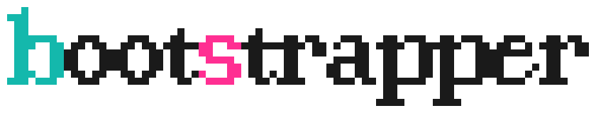
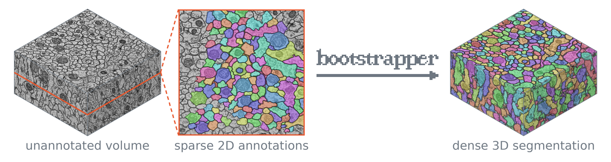
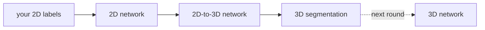

<h1 align="center">
  <picture>
    <source media="(prefers-color-scheme: dark)" srcset="docs/assets/logo-dark.svg">
    
  </picture>
</h1>

[](https://github.com/ucsdmanorlab/bootstrapper/actions/workflows/ci.yml)

Bootstrapper makes dense 3D instance segmentations of a microscopy volumes from sparse 2D labels.



## Install

You need [uv](https://docs.astral.sh/uv/), a C/C++ compiler, and a GPU for training.

```
uv venv --python 3.12 && source .venv/bin/activate
uv pip install git+https://github.com/ucsdmanorlab/bootstrapper.git
```

## Use

A Bootstrapper round trains a model on your labels and segments the volume, and the next round can train on that segmentation.
Each round is a folder, here `round_01`.

```
bs prepare round_01    # asks about your image and your labels
bs run round_01        # trains, predicts and segments
bs view round_01       # prints a link that shows the result in a browser
```

## Example

The figure above shows a run of these commands on CREMI A, with 151 objects traced on one section.
The download is 3.9 GB, of which 59 MB is kept, and training takes 23 minutes on one RTX 4090.

```
curl -L "https://zenodo.org/records/21223591/files/data.tar?download=1" | tar xf - --strip-components=1 data/cremi_a
bs prepare round_01 --raw cremi_a/volume_1.zarr/raw --labels sparse_labels --labelled sparsely
bs run round_01
```

## How it works



Each step of a round is a commented file in `round_01/`, and `bs <command> --help` lists every option.

## Paper

The paper's results come from [bootstrapper_nm_capsule](https://github.com/ucsdmanorlab/bootstrapper_nm_capsule), which uses Bootstrapper v0.3.2.
For questions, contact vvenu@utexas.edu.
If you use Bootstrapper, please cite the [preprint](https://doi.org/10.1101/2024.06.14.599135):

```
@article {Thiyagarajan2024.06.14.599135,
	author = {Thiyagarajan, Vijay Venu and Sheridan, Arlo and Harris, Kristen M. and Manor, Uri},
	title = {A general method for bootstrapping dense 3D segmentations from sparse 2D annotations},
	journal = {bioRxiv},
	year = {2026},
	doi = {10.1101/2024.06.14.599135},
	URL = {https://doi.org/10.1101/2024.06.14.599135},
}
```

## Funding

Chan-Zuckerberg Imaging Scientist Award DOI https://doi.org/10.37921/694870itnyzk from the Chan Zuckerberg Initiative DAF, an advised fund of Silicon Valley Community Foundation (funder DOI 10.13039/100014989).

NSF NeuroNex Technology Hub Award (1707356), NSF NeuroNex2 Award (2014862)


